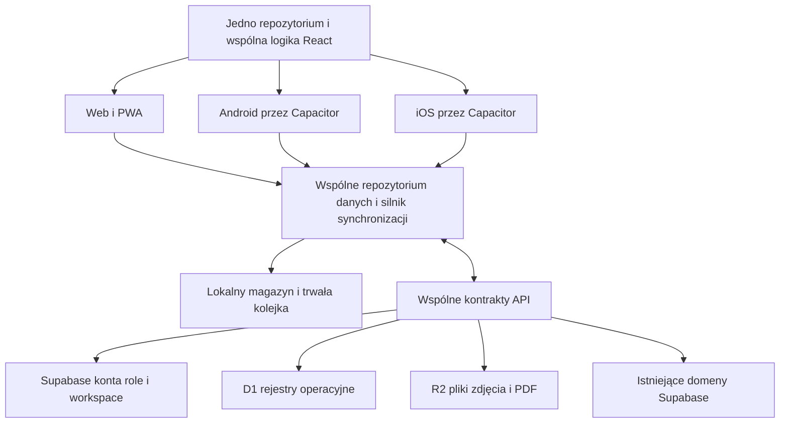

# Plan wspólnej aplikacji MySafeOps na web Android i iOS

Data: 7 października 2026. Status: plan wdrożenia po przeglądzie kodu. Zakres obejmuje wspólną aplikację, dane, pracę offline, szablony, eksporty i wydawanie aktualizacji. Nie ograniczamy telefonu do kilku formularzy. Interfejs może dostosowywać się do ekranu, a obsługa urządzenia do platformy.

**Rekomendacja: utrzymać jedno repozytorium, wspólny frontend React/Vite i wspólną logikę biznesową; dodać Android/iOS przez Capacitor. Najpierw uporządkować zapis i synchronizację, następnie wydawanie wersji i pakiety natywne.** Zmianę funkcji RAMS będziemy implementować raz, testować wspólnie i wydawać na wszystkie platformy. Dokument zmieniony przez użytkownika będzie jednym rekordem w tym samym środowisku chmurowym, z lokalnymi kopiami na urządzeniach.

## Konta i dostęp do wspólnych danych

Zakładamy jedno konto na osobę; przełączanie kilku kont na jednym telefonie nie jest planowaną funkcją produktu. Ta sama osoba loguje się na webie i telefonie **tym samym kontem**. Rejestracja pod nowym adresem e-mail tworzy nowego użytkownika, a bez zaproszenia również nową organizację — nie przenosi dokumentów ze starego konta. Nowy pracownik, który ma widzieć RAMS i inne dane istniejącej firmy, zakłada własne konto przez zaproszenie wysłane na jego adres przez administratora firmy. Zaproszenie e-mail wymaga zgodności adresu; linki dołączania mogą wymagać potwierdzonego adresu i właściwej domeny.

W testach chmurowych trzeba więc rozdzielić trzy ścieżki: ta sama osoba na webie i telefonie, drugi użytkownik dołączający do tej samej organizacji oraz nowy użytkownik bez zaproszenia z osobną organizacją. Przy wymianie prywatnego adresu na nowy nie zakładamy automatycznego transferu konta ani danych; byłby to osobny proces z weryfikacją własności. Mimo że codzienne przełączanie kont na urządzeniu nie jest wymaganiem, cache i niewysłane zmiany nadal muszą mieć właściciela: wylogowanie, utrata telefonu lub przekazanie urządzenia innej osobie nie może ujawnić ani wysłać cudzych danych.

## Postęp pierwszego etapu zabezpieczeń

7 października wykonano lokalnie pierwszą część etapu 1:

- Każdy nowy wpis kolejki ma identyfikator operacji. Usunięcie po potwierdzeniu serwera porównuje ten identyfikator w transakcji IndexedDB. Odpowiedź starszego uploadu nie usuwa nowszego wpisu.
- Przy konflikcie outbox zapisuje trwałą kopię oczekującego payloadu i odpowiedzi serwera, zanim usunie dokładnie ten wpis kolejki. Nie podmienia edytora odpowiedzią serwera. Bezpośrednia ścieżka zapisu hooka również archiwizuje obie wersje i zachowuje lokalną edycję. Do czasu ręcznego rozstrzygnięcia konfliktu nie wysyła dalszych zmian tej listy do chmury.
- Kopie są w oddzielnym IndexedDB `mysafeops_d1_recovery`, a baza kolejki zachowuje wersję 1. Test obejmuje starsze wpisy bez identyfikatora operacji. Stara wersja aplikacji nadal ma swoje dotychczasowe zachowanie — nowe zabezpieczenia wymagają załadowania nowego kodu.
- Brak uprawnień lub blokada billingowa nie usuwa oczekującego payloadu. Wersja 0 przy wysyłaniu jest warunkiem utworzenia nowego klucza, nie zgodą na nadpisanie istniejących danych bez kontroli wersji.
- Zapis hooka ignoruje spóźnione odpowiedzi po nowszej edycji lub zmianie zakresu. Potwierdzenie kolejki nie aktualizuje stanu innego aktywnego workspace.
- Workspace pokazuje komunikat i możliwość pobrania kopii konfliktów do JSON. Lista i eksport są rozdzielone według firmy oraz kraju; późna odpowiedź z poprzedniego zakresu jest pomijana. Pobranie nie usuwa kopii i nie przywraca automatycznie danych.

Weryfikacja: 58 testów w 9 plikach przeszło (`output/sync-safety-unit-final.log`). Trwałość kopii oraz nowszego wpisu kolejki po reloadzie przeszła w 3 profilach Playwright: desktop Chromium, Pixel 7 Chromium i iPhone 13 WebKit (`output/sync-safety-e2e.log`). To lokalne testy rzeczywistego IndexedDB przeglądarek, bez połączenia z produkcyjną chmurą. Build Vite przeszedł (`output/sync-safety-build.log`); lint repozytorium ma 0 błędów i 128 ostrzeżeń, a celowany lint zmienionej logiki, nowych komponentów i testów ma 0 ostrzeżeń.

Etap 1 pozostaje w toku. Kopia konfliktu jest zabezpieczeniem do odzyskania danych, nie pełnym interfejsem rozstrzygania różnic. Następne prace: porównanie i kontrolowane przywracanie rewizji, wspólna transakcja rekordu z kolejką przed potwierdzeniem zapisu, synchronizacja niezależna od modułu oraz dalsze testy hydracji i zmiany konta. Kopie nadal podlegają ograniczeniom magazynu przeglądarki i znikną po wyczyszczeniu jej danych. Nie wykonano deploya ani migracji chmury.

### Kontynuacja przeglądu: zmiana firmy, kraju i sesji

W dalszym przeglądzie 7 października odtworzono lokalnymi testami i poprawiono:

- **Spóźniony odczyt poprzedniego workspace.** Hydracja sprawdzała głównie zamknięcie efektu React. Odpowiedź mogła zostać użyta po zmianie aktywnej firmy lub kraju, zanim React wykonał cleanup. Hook sprawdza teraz także bieżący zakres z magazynu przed użyciem odpowiedzi oraz po oczekiwaniu na ponowną próbę. Spóźniony początkowy PUT nie zmienia numeru wersji nowej firmy.
- **Zmianę kraju w otwartym module.** Hook reaguje na zdarzenie zmiany kraju, unieważnia poprzednie operacje, ładuje lokalne dane nowego zakresu i rozpoczyna jego hydrację. Nie polega wyłącznie na przeładowaniu strony wykonywanym obecnie przez przełącznik kraju. Aktualizacja nazwy lub billingu bez zmiany klucza danych nie resetuje edytora.
- **Konflikt kolejki po zmianie zakresu.** Jeżeli zakres przestał być aktywny w trakcie uploadu albo pobierania konfliktu, kolejka pozostaje do kolejnej próby. Już potwierdzony upload może nadal usunąć wyłącznie odpowiadający mu wpis starego zakresu; nie ustawia wersji nowego workspace.
- **Cache D1 współdzielony między sesjami.** Poprzedni cache i deduplikacja GET używały tylko firmy, namespace i klucza. Test wykazał, że drugiej sesji zwracano sukces pierwszej zamiast wykonać jej żądanie, które w teście odpowiadało 403. Cache oraz współdzielenie trwającego GET wymagają teraz identycznej autoryzacji sesji. Zakończenie starego żądania nie usuwa rejestracji nowego. Dotyczy to pamięci procesu; nie dodano tokenów do magazynu lokalnego ani logów.

Dowody: trzy nowe przypadki zakresu nie przechodziły przed poprawką (`output/sync-scope-before.log`), a dwa przypadki rozdzielenia sesji nie przechodziły przed poprawką klienta (`output/sync-session-before.log`). Po zmianach przechodzą **73 testy w 10 plikach** (`output/sync-scope-unit-final.log`), obejmujące też istniejące zasady billingu, kolejkę, archiwum konfliktów, bibliotekę dokumentów i magazyn lokalny. Testy odpowiedzi serwera korzystają z mocków; nie są dowodem przebiegu sesji na produkcji.

Build Vite po tej rundzie przeszedł (`output/sync-scope-build.log`). Test zachowania kolejki i kopii konfliktów po przeładowaniu przeszedł ponownie w trzech profilach przeglądarek: desktop, Pixel 7 i iPhone 13 WebKit (`output/sync-scope-e2e.log`). Ten test przeglądarkowy potwierdza trwałość IndexedDB, a nie prawdziwe logowanie dwóch kont ani natywne pakiety Android/iOS. Celowany ESLint zmienionych plików ma 0 ostrzeżeń; pełny lint repozytorium ma 0 błędów i 128 istniejących ostrzeżeń (`output/sync-scope-lint.log`).

Pozostałe warunki przed uznaniem synchronizacji za gotową:

| Priorytet | Następna praca | Warunek odbioru |
| --- | --- | --- |
| P0 | Atomowy lokalny zapis dokumentu i operacji do wysłania; pilot RAMS | Zamknięcie procesu bezpośrednio po potwierdzeniu zapisu nie gubi kolejki. Brak miejsca nie daje fałszywego potwierdzenia. Migracja zachowuje stare dane. |
| P0 | Właściciel lokalnych danych i sesja | Test kont A → wylogowanie → B, również w tej samej firmie i przy odebranym dostępie do kraju. B nie ogląda ani nie wysyła prywatnej kolejki A; niewysłane dokumenty A pozostają do bezpiecznego odzyskania. Obecne klucze kolejki/localStorage rozróżniają firmę i kraj, ale nie użytkownika. To zabezpieczenie przekazanego urządzenia, nie funkcja codziennego przełączania kont. Poprawka cache GET nie rozwiązuje tego całego scenariusza. |
| P0 | Zachowanie obu wersji również podczas początkowego scalania | Odczyt przy uruchomieniu nie usuwa niezarchiwizowanej lokalnej edycji przez porównanie zegarów. Test dwóch urządzeń zmieniających ten sam RAMS, w tym zegar telefonu ustawiony błędnie. |
| P1 | Jeden koordynator synchronizacji niezależny od ekranu | Zapis z propagacji dokumentu lub zamkniętego modułu dociera do chmury i drugiego urządzenia bez otwierania tego modułu. |
| P1 | Kontrolowane rozwiązanie konfliktu | Użytkownik widzi różnice i świadomie wybiera wynik; zapis tworzy nową rewizję z kontrolą wersji. Archiwum źródłowe nie znika przed potwierdzeniem. |
| P1 | Uprawnienia online i wygasanie dostępu offline | Integracyjne testy admin/supervisor/operative oraz przypisań kraju sprawdzają D1, R2 i Supabase. Wspólny dokument zasad określa, jak długo wcześniej zatwierdzony dostęp offline działa po utracie łączności. Samo ukrycie przycisku nie jest kontrolą dostępu. |

Kolejność pozostaje bez zmian: bezpieczeństwo zapisu i tożsamości → wspólne repozytorium RAMS → globalna synchronizacja → adaptery natywne → wydania sklepowe. Ten przegląd nie oznacza zakończenia całego QA, testów fizycznych urządzeń ani audytu uprawnień backendu.

## Naprawy w obecnym edytorze RAMS przed migracją

Kolejny przegląd objął rzeczywistą ścieżkę zapisu, kopiowanie do projektu i synchronizację powiązanego method statement. Te zmiany są podłączone do obecnego interfejsu; nie wymagają włączenia przyszłego adaptera IndexedDB:

- `RAMSTemplateBuilder.jsx` usuwa kopię roboczą dopiero po przejściu walidacji i potwierdzeniu zapisu dokumentu na urządzeniu. Wcześniej usuwał ją przed częścią kontroli wydania/akceptacji. Wycofana walidacja pozostawia teraz kopię.
- Nowy pomocniczy `ramsDocumentSave.js` sprawdza wynik `saveOrgScoped`. Przy odmowie zapisu edytor pozostaje otwarty, pokazuje błąd i nie wyświetla animacji wydania ani nie zlicza użycia szablonów. Przejście do listy oznacza potwierdzony zapis lokalny, nie potwierdzenie chmury.
- Zapis odczytuje aktualną listę z magazynu, zachowując dokumenty dodane poza otwartym formularzem. Porównuje edytowany dokument z pierwotną wersją i odrzuca nadpisanie, jeżeli został zmieniony, usunięty lub zastąpiony tombstone. Sprawdza też, czy firma/kraj odpowiadają zakresowi, w którym otwarto edytor.
- `ramsDocumentClone.js` tworzy kopię z oboma polami statusu ustawionymi na `draft`. Resetuje podpisy, zatwierdzenia, akceptację klienta, historię zatwierdzonych rewizji i potwierdzenie competent review. Nowa rewizja zaczyna się od `1A`; autorstwo pochodzi z bieżącego cache autora, a powiązanie ze źródłem pozostaje w `clonedFromRamsId`/`clonedFromProjectId`. Oryginał nie jest zmieniany. Zagnieżdżone dane są kopiowane, zamiast współdzielić obiekty źródła.
- Kopiowanie pojedyncze i grupowe zgłasza błąd przy odmowie zapisu. Po sukcesie odświeża stan listy edytora, dzięki czemu kopia jest od razu widoczna i trafia do istniejącej ścieżki synchronizacji hooka. Wcześniej zapis do localStorage nie aktualizował tej listy.
- Zwykły przycisk `Duplicate` oraz kopiowanie RAMS przy kopiowaniu projektu korzystają z tej samej funkcji tworzenia niepodpisanego szkicu. Poprzednie niezależne implementacje dziedziczyły `documentStatus`, podpisy i zatwierdzenia. `Duplicate` potwierdza zapis przed pokazaniem sukcesu; kopiowanie projektu pomija usunięte RAMS i zgłasza odmowę ich zapisu.
- Na małym ekranie akcje zapisanych RAMS układają się pod opisem dokumentu i mieszczą w szerokości karty. Poprzedni nieskurczalny panel o szerokości do 420 px wychodził poza kartę, uniemożliwiając normalne kliknięcie `Edit`. Test odtworzył to na Pixel 7 i iPhone 13 WebKit (`output/rams-save-clone-e2e-final.log`); po poprawce oba profile przeszły (`output/rams-save-clone-e2e-verified.log`).
- `fessMsSync.js` nie zgłasza sukcesu, jeśli powiązany method statement nie został zapisany. Edytor rozróżnia zapisany RAMS od nieudanego zapisu MS i informuje o częściowym wyniku. Awaria pomocniczej operacji nie udaje nieudanego zapisu już utrwalonego RAMS.

To zabezpieczenia przejściowe: odczyt–porównanie–zapis localStorage nie jest transakcją między kartami. Nie zastępuje docelowego repozytorium per-record, kontroli rewizji na serwerze ani migracji danych między kontami. Nowsza poprawka szkiców jest opisana poniżej; wspólny cache zapisanych dokumentów i starsza kolejka nadal wymagają migracji według właściciela.

Przypadki kopiowania odtworzono przed poprawką w `output/rams-clone-before.log`; test interfejsu potwierdził brak natychmiastowej aktualizacji listy (`output/rams-clone-before-e2e.log`). Dwa testy odmowy zapisu MS nie przechodziły przed poprawką (`output/rams-ms-before.log`). Po zmianach **127 testów w 16 plikach przeszło** (`output/rams-save-clone-unit-verified.log`).

Końcowy build Vite przeszedł (`output/rams-save-clone-build-complete.log`). Pełny lint ma 0 błędów i 128 istniejących ostrzeżeń (`output/rams-save-clone-lint-complete.log`), celowany lint pomocniczej logiki i testów ma 0 ostrzeżeń (`output/rams-save-clone-target-lint.log`).

Końcowy przebieg Playwright: **15/15** — pięć scenariuszy w każdym z profili desktop Chromium, Pixel 7 Chromium i iPhone 13 WebKit (`output/rams-save-clone-e2e-complete.log`). Obejmuje zachowanie szkicu po nieudanej walidacji, odmowę zapisu i ponowienie, kopiowanie do projektu, zwykłe duplikowanie oraz odrzucenie zapisu dokumentu zmienionego poza formularzem. Są to testy przeglądarek z wyłączoną chmurą, nie testy fizycznych telefonów, pakietów natywnych ani produkcyjnej synchronizacji.

Propagacja survey otrzymała zabezpieczenia opisane poniżej. Pozostałe zapisy między modułami i kopiowanie innych typów dokumentów nadal wymagają wspólnego repozytorium, jawnego wyniku każdej operacji i ochrony podpisanych rewizji. Naprawa RAMS nie jest dowodem poprawności tych pozostałych ścieżek.

### Aktualizacja RAMS z ankiety i kopiowanie powtórnej wizyty FESS

Ścieżki `persistRamsSyncFromSurvey`, `persistSurveyAppendixToRams` oraz zbiorcze dodawanie załączników w `documentPropagation.js` korzystają teraz z porównania pierwotnego dokumentu w `commitRamsDocument`. Potwierdzone lokalnie problemy obejmowały nadpisanie nowszej treści, odtworzenie usuniętego RAMS z nieaktualnej listy, modyfikację podpisanej wersji, fałszywy sukces zapisu i utratę innych dokumentów podczas zapisu całej starej listy.

- Propagacja odmawia zmiany dokumentu zatwierdzonego, wydanego, podpisanego, archiwalnego lub zastąpionego. Sprawdza oba pola statusu oraz dowody zatwierdzenia i podpisy, również przy statusie `draft`. Komunikat kieruje do utworzenia i powiązania niepodpisanego szkicu. Sam wpis o ustawieniu daty wydania w `internal_review` nie jest traktowany jak podpis.
- Usunięty lub brakujący jawnie wskazany RAMS nie jest zastępowany innym dokumentem projektu. Link do innego przypisanego projektu jest odrzucany. Wyszukiwanie pomija usunięte RAMS, a zbiorcza operacja pomija usunięte finalne ankiety.
- Każdy zapis wymaga potwierdzonego wyniku magazynu. Operacja zbiorcza zwraca wynik każdego elementu, zachowuje wcześniej zapisane elementy przy późniejszej awarii i przerywa zapisy do zmienionego zakresu firmy/kraju. Interfejs rozróżnia pełny sukces, częściowy sukces i brak zapisu oraz podaje rzeczywiste powody zamiast zawsze pisać „no RAMS”. Ponowienie pobiera aktualną listę RAMS i nie duplikuje załącznika.
- Aktualizacja załącznika zastępuje wyłącznie poprzedni wygenerowany tekst zapisany w metadanych danego survey. `SR-1` nie usuwa `SR-10`; obsługiwane są znaki specjalne i zmiana referencji tego samego survey. Ręczne notatki dopisane za blokiem pozostają. Jeśli stary blok został ręcznie zmieniony, nie jest automatycznie kasowany.
- Zmiana unieważnia dotychczasowy fingerprint treści i zapisuje bieżącego redaktora z istniejącego cache autora. Nie przypisuje mu autorstwa starego dokumentu o nieznanym twórcy.
- `duplicateFessRamsForSite` korzysta ze wspólnej funkcji tworzenia kopii RAMS: czyści status wydania, podpisy i zatwierdzenia; pomija usunięte źródła. Gdy zapis się nie uda, zwraca błąd i nie otwiera nieistniejącej kopii.

Przed poprawką odtworzono **26 nieprzechodzących przypadków propagacji** (`output/survey-rams-propagation-before.log`) oraz trzy błędy ścieżki powtórnej wizyty FESS (`output/fess-repeat-copy-before.log`). Po zmianach przechodzi **76 testów w 6 plikach** (`output/survey-rams-propagation-unit-complete.log`). Dwa scenariusze interfejsu — częściowy sukces z chronionym wydanym RAMS oraz odmowa zapisu i ponowienie — przeszły w trzech profilach przeglądarek: **6/6** (`output/survey-rams-propagation-e2e.log`).

Build Vite przeszedł (`output/survey-rams-propagation-build.log`); pełny lint ma 0 błędów i 128 istniejących ostrzeżeń (`output/survey-rams-propagation-lint-complete.log`). Zmienione pomocnicze moduły i ich testy oraz plik E2E przechodzą ESLint z limitem 0 ostrzeżeń (`output/survey-rams-propagation-strict-lint.log`).

To nadal potwierdzenie zapisu na urządzeniu. Nie dodano globalnego koordynatora wysyłania zmian z zamkniętego modułu RAMS, transakcji między kartami ani niezmiennych rewizji na serwerze. Samo zablokowanie propagacji do podpisanego dokumentu nie jest kompletną kontrolą wszystkich innych dróg edycji w aplikacji.

### Szablony, playbooki i portal klienta

W kolejnym przeglądzie sprawdzono ścieżki tworzące dokumenty poza głównym edytorem RAMS:

- Klonowanie RAMS z `DocumentTemplates` używa teraz tej samej funkcji co kopiowanie projektu i powtórna wizyta FESS. Szablon utworzony z wydanego dokumentu nie przenosi podpisów, zatwierdzeń, historii rewizji ani tokenu udostępniania. Lista szablonów i źródeł pomija tombstone.
- `applyAndPersistProjectPlaybook` sprawdza wynik każdego zapisu. Błąd miejsca lub blokady zapisu jest zwracany do interfejsu jako ostrzeżenie; nie pojawia się komunikat o pełnym zastosowaniu playbooka, kiedy RAMS nie został zapisany. Zapis wielu rejestrów pozostaje sekwencyjny, więc docelowy adapter repozytorium musi zapewnić transakcję albo jawny stan częściowy.
- Kopiowanie projektu dla survey, permitów, method statements i geo-photos pomija usunięte źródła, zgłasza błąd zapisu i tworzy szkice bez podpisów oraz workflow wydania. Oryginalne rejestry są zachowane.
- Akceptacja RAMS w lokalnym portalu klienta korzysta z kontroli zakresu firmy/kraju i porównania pierwotnej wersji. Równoległa zmiana dokumentu nie jest nadpisywana; użytkownik dostaje prośbę o odświeżenie. Opublikowany portal chmurowy nadal jest tylko do odczytu.

Po tych zmianach celowane testy propagacji, klonowania i playbooków przechodzą **58/58 w 3 plikach**. Pełny ESLint przechodzi z 0 błędów (pozostają istniejące ostrzeżenia repozytorium), a build Vite przechodzi. Nie wykonano deploya ani migracji danych. Zapis listowy nadal może pozostawić wcześniej zapisane rejestry przy awarii kolejnego zapisu; to świadome zabezpieczenie przed utratą danych, a nie docelowa transakcja wielorejestrowa.

### Kontynuacja 8 października: spójność kopii, projektów FESS i kosza

Przegląd ujawnił kolejne potwierdzone problemy w ścieżkach przygotowania pakietu na inne urządzenie:

- Kopia projektu łączy nową ankietę, permit i method statement z nową kopią RAMS. Jeśli RAMS nie jest kopiowany, usuwa stare odnośniki. Nowy RAMS nie dziedziczy identyfikatorów i załączników ankiet źródłowego projektu. Ankieta otrzymuje nazwę nowego projektu i traci stare podpisy, datę finalizacji oraz odnośniki do GPR/permitów; method statement traci zatwierdzenie i podpisy operatywów. Treść opisowa nadal wymaga ręcznego sprawdzenia pod kątem nazw i danych starej lokalizacji.
- FESS nie zwraca nowego projektu, gdy jego zapis się nie udał. Masowe tworzenie lokalizacji zgłasza błąd zamiast podawać fikcyjną liczbę utworzonych projektów; onboarding nie nazywa tego sukcesem. Uruchomienie pakietu sygnalizuje, gdy późniejszy zapis danych projektu się nie udał, i informuje, że wcześniejsze dokumenty mogły już zostać zapisane. Statystyki lokalizacji pomijają usunięte rekordy.
- Ekran szablonów nie zapisuje listy przy samym otwarciu. Po zmianie firmy lub kraju wczytuje właściwy zakres; utworzenie szablonu wymaga potwierdzonego zapisu. Nowe szablony RAMS i method statement są tworzone jako szkice bez podpisów oraz danych zatwierdzenia. Kopia method statement zaczyna nową rewizję. Historyczne szablony zapisane przed poprawką mogą nadal zawierać stare dane zatwierdzenia w lokalnym magazynie; przed migracją do chmury trzeba je zinwentaryzować i oczyścić z kopią odzyskiwania. Szablony nadal używają lokalnego rejestru i wymagają włączenia do docelowego wspólnego repozytorium, by nowy szablon pojawiał się na drugim urządzeniu.
- Kosz uznaje usunięcie za zabezpieczone dopiero po zapisaniu kopii odzyskiwania. Nie usuwa wpisu przy nieudanym przywróceniu i nie nadpisuje nowszego żywego rekordu starszą kopią. Ekran zgłasza również nieudaną operację trwałego usunięcia. Pozostaje do zaprojektowania jedna transakcja dla wpisu kosza i tombstone w źródłowym rejestrze.

Celowane testy po tej rundzie: **75/75 w 6 plikach**. Trzy scenariusze RAMS/survey w izolowanej konfiguracji Playwright przeszły we wszystkich trzech profilach: **9/9** desktop, Android i iPhone WebKit. To testy przeglądarek, nie pakietów natywnych. Pełny lint repozytorium przeszedł z 0 błędów i 128 wcześniejszymi ostrzeżeniami; celowany lint zmienionych plików ma 0 ostrzeżeń. Build Vite przeszedł po ostatniej zmianie. Zwykły lokalny serwer z aktywną konfiguracją Supabase skierował pierwszy przebieg Playwright na ekran logowania; wynik nie dotyczył funkcji i został powtórzony w poprawnej izolowanej konfiguracji.

### Kontynuacja: opóźniony zapis wspólnego hooka D1

Test odtworzył możliwość zapisania listy starej firmy pod kluczem nowej firmy, gdy przełączenie workspace nastąpiło między renderem React a wykonaniem efektu lokalnego zapisu w `useD1OrgArraySync`. Ten sam przypadek dotyczył zmiany kraju. Efekt sprawdza teraz zakres firmy, namespace i kraju uchwycony w renderze bezpośrednio przed `saveOrgScoped`. Testy obu przełączeń nie przechodziły przed zmianą i przechodzą po niej; cały plik hooka ma **13/13** poprawnych testów.

Ta kontrola zamyka konkretny wyścig efektu React. Istniejący lokalny magazyn wielu modułów nadal rozdziela dane według firmy i kraju, a nie konta użytkownika; plan migracji danych użytkowników i sesji pozostaje priorytetem P0. Inne bezpośrednie zapisy modułów muszą przejść przez wspólne repozytorium, zanim będzie można gwarantować spójność na wszystkich urządzeniach.

Ekran Kosza odświeża teraz widoczne wpisy również po zmianie firmy i kraju. Test komponentu potwierdza, że po obu przełączeniach nazwy pozycji poprzedniego workspace znikają z otwartego ekranu. To poprawia izolację interfejsu, lecz obecny kosz jest nadal magazynem lokalnym przypisanym do firmy/kraju, bez właściciela konta i synchronizacji między urządzeniami (`LOCAL_ONLY_STORAGE_KEYS` w `syncCoverage.js`).

Przy kopiowaniu pakietu do innego projektu późniejszy błąd zapisu podaje teraz liczbę dokumentów, które zostały już zapisane, i ostrzega przed bezrefleksyjnym ponowieniem prowadzącym do duplikatów. Test sprawdza rzeczywisty stan po udanym zapisie RAMS i nieudanym zapisie ankiety. Nie jest to atomowy zapis całego pakietu: przed jego wdrożeniem potrzebny będzie identyfikator operacji i trwały dziennik częściowych kroków albo transakcja wspólnego repozytorium.

Pełny Vitest po poprawce hooka: **1979/1979 testów w 348 plikach** (`output/cross-platform-oct08-unit-final.log`). Potem przeszły celowane testy nowego odświeżania kosza (**9/9 w 2 plikach**) i częściowego kopiowania (**45/45 w pliku propagacji**). Pełny ESLint po ostatniej zmianie: 0 błędów i 128 wcześniejszych ostrzeżeń (`output/cross-platform-oct08-lint-complete.log`); build Vite przeszedł (`output/cross-platform-oct08-build-complete.log`).

Następny test odtworzył utratę widocznej lokalnej edycji po `version_conflict`: serwerowy rekord z późniejszym `updatedAt` zastępował ją w edytorze mimo zapisania kopii odzyskiwania. Hook pozostawia teraz edycję i lokalny cache bez zmian. Przy ponownym otwarciu sprawdza kopie konfliktów dla dokładnej firmy, namespace i klucza kraju; nie scala takiej listy z odpowiedzią serwera ani nie wysyła jej ponownie z nowo pobraną wersją. Lista z oczekującą operacją również pozostaje widoczna podczas jej weryfikacji. Kolejne lokalne edycje w nierozstrzygniętej liście nie są wysyłane, lecz pozostają w dotychczasowym lokalnym cache. **To wstrzymanie nie jest rozstrzygnięciem konfliktu**: przed użyciem tej listy na innych urządzeniach trzeba porównać eksportowane kopie i wdrożyć kontrolowaną operację scalenia/potwierdzenia. Obecny lokalny cache nadal nie daje gwarancji atomowego zapisu z kolejką ani izolacji konta.

Weryfikacja tej kontynuacji: test regresji nie przechodził przed poprawką. Po zmianach testy hooka i outboxa przeszły **33/33**, a testy biblioteki dokumentów i komunikatu odzyskiwania **7/7**. Build produkcyjny oraz celowany ESLint z limitem 0 ostrzeżeń przeszły. Dwa wcześniejsze pełne uruchomienia Vitest miały po **1983 poprawne i 2 nieudane testy**: pierwszy wykazał brak nowej funkcji w mocku biblioteki (poprawiony i potwierdzony testem celowanym), drugi przekroczył limity czasu dwóch niezwiązanych testów renderowania dashboardu i generowania survey. Ponowny przebieg tych dwóch plików wraz z czterema zmienionymi obszarami przeszedł **145/145 w 6 plikach**. Ostateczny pełny Vitest z czterema workerami i limitem 30 s na test przeszedł **1985/1985 w 349 plikach**. Standardowy przebieg z domyślną równoległością pozostaje niestabilny czasowo w tym lokalnym środowisku; nie zmieniano implementacji raportu ani dashboardu pod jego timeouty.

### Szkice RAMS i wznowienie edycji

`ramsBuilderDraft.js` zastępuje pojedynczy klucz formularza nowymi kopiami sesyjnymi rozdzielonymi według konta, klucza firmy/kraju i dokumentu. To aktualizacja działającego edytora, niezależna od przyszłego adaptera IndexedDB.

- Szkic zapisuje ID dokumentu oraz pierwotny `editingDocument`. Po wznowieniu aktualizuje ten sam rekord; kontrola zmiany oryginału nadal odrzuca nadpisanie nowszej wersji. Nowy dokument zachowuje jedno ID od otwarcia formularza, także po ponowieniu zapisu.
- Lista RAMS umożliwia wybór zachowanego szkicu z bieżącego zakresu. Rozpoczęcie kolejnego formularza nie usuwa innych szkiców. Udany zapis usuwa wyłącznie kopię danego dokumentu. Stare poprawne kopie nie wygasają automatycznie po siedmiu dniach.
- Właściciel pochodzi z istniejącego kontekstu zalogowanego użytkownika. Brak sesji przy skonfigurowanym Supabase blokuje otwarcie edytora; jawny tryb lokalny bez Supabase ma oddzielny zakres. Nie zmieniano API logowania ani uprawnień chmury.
- Zmiana konta albo workspace zamyka formularz i próbuje utrwalić go w pierwotnym zakresie. Nie przypisuje jego treści nowemu użytkownikowi. Odmowa tej próby daje komunikat o nieudanym odzyskiwaniu; nie obiecujemy zachowania ostatnich zmian przy niedostępnym magazynie.
- Autosave zachowuje opóźnienie 1200 ms; dodatkowe próby wykonuje przy `pagehide`, ukryciu karty, powrocie do listy oraz demontażu edytora. Nieudany zapis pokazuje ostrzeżenie i nie podmienia poprzedniej kopii. Zdarzenia lifecycle nie gwarantują zapisu przy nagłym zabiciu procesu systemowego.
- Starszy `mysafeops_rams_builder_draft` pozostaje bez zmian. Ponieważ nie określa właściciela i zakresu, nie jest automatycznie otwierany, usuwany ani migrowany. Interfejs informuje o zachowanej kopii. Kontrolowane odzyskanie wymaga najpierw ustalenia właściciela i workspace; dopiero wtedy kopia może zostać ręcznie odtworzona jako zweryfikowany szkic. Starszy format nie zawiera wiarygodnego pierwotnego snapshotu do automatycznego nadpisania istniejącego RAMS.

To nadal `sessionStorage`: kopia służy wznowieniu pracy w danej karcie, a nie trwałemu przechowywaniu offline po zamknięciu przeglądarki. Nie ma gwarancji przetrwania usunięcia danych przeglądarki, zamknięcia karty ani awarii urządzenia. Docelowy zapis dokumentu i kolejki w IndexedDB/SQLite pozostaje osobnym etapem. Globalny prefill AI, cache zapisanych rejestrów i kolejka nie zostały przeniesione do tego nowego zakresu.

Weryfikacja lokalnej logiki: **147/147 testów w 17 plikach**, w tym 20 przypadków nowego magazynu szkiców (`output/rams-draft-unit-final.log`). Testy rozdzielenia użytkowników podają jawne identyfikatory zakresów; nie zastępują testu prawdziwych sesji A → wylogowanie → B ani audytu autoryzacji backendu.

Build Vite przeszedł (`output/rams-draft-build.log`). Pełny lint: 0 błędów i 128 istniejących ostrzeżeń (`output/rams-draft-lint-final.log`). Nowy moduł, jego testy oraz plik E2E przechodzą ESLint z limitem 0 ostrzeżeń (`output/rams-draft-strict-lint.log`).

W Playwright przeszły **33/33 scenariusze edytora RAMS**: 11 przypadków na desktop Chromium, Pixel 7 Chromium i iPhone 13 WebKit, w tym sześć nowych scenariuszy odzyskiwania. Obejmują wznowienie edycji istniejącego dokumentu, zachowanie kontroli konfliktu po reloadzie, pozostawienie starszego formatu, wybór wcześniejszego szkicu, odmowę zapisu sesyjnego i zmianę organizacji. Rozszerzony przebieg (`output/rams-draft-e2e-final.log`) miał łącznie 36 poprawnych przypadków, dwa planowo pominięte mobilne eksporty PDF oraz jeden timeout dodatkowego testu dashboardu na Androidzie. Timeout nastąpił przed znalezieniem `#main-content`, na ekranie `Loading…`, zanim zaczęły się sprawdzenia dashboardu; ślad zachowano w `output/rams-draft-playwright-final`. Ten sam test dashboardu przeszedł w osobnym ponowieniu, bez zmian kodu i limitu czasu (`output/rams-draft-dashboard-recheck.log`). Nie ustalono jednoznacznej przyczyny pojedynczego opóźnienia startu.

## Fundament atomowego zapisu — gotowy do pilota RAMS, jeszcze nieaktywny w modułach

Dodano `src/data/storage/offlineRecordStore.js` oraz testy. Jest to nowy adapter IndexedDB dla repozytorium dokumentów. **Nie został podłączony do obecnego edytora RAMS, starego hooka D1 ani istniejących zapisów localStorage. Nie rozwiązuje jeszcze problemu rozdzielenia obecnych danych między kontami.** Włączenie go bez migracji cache i serwerowego kontraktu byłoby pozornym zabezpieczeniem: drugi użytkownik mógłby nadal wczytać stary wspólny cache przez dotychczasowy moduł.

### Co zapewnia nowy adapter

- Wymaga jawnego zakresu `userId + orgSlug + countryKey`, namespace i identyfikatora rekordu. Nie przyjmuje brakującego konta, firmy `default` ani domyślnego kraju. `primary` jest świadomie przekazanym kluczem kraju głównego.
- Dokument i najnowszy wpis kolejki powstają w jednej transakcji. Promise zapisu kończy się sukcesem dopiero po zdarzeniu zakończenia transakcji. Brak miejsca, blokada magazynu lub przerwanie zapisu kolejki nie pozostawiają połowy operacji.
- Zapis wymaga oczekiwanej lokalnej rewizji. Dwie karty edytujące tę samą rewizję nie nadpisują się bez wykrycia konfliktu. Dane wywołującego są kopiowane przed rozpoczęciem transakcji.
- Każda zmiana ma nowy identyfikator operacji. Potwierdzenie chmury usuwa tylko dokładnie pasującą kolejkę i w tej samej transakcji aktualizuje wersję serwera dokumentu. Spóźnione potwierdzenie starszej edycji nie oznacza nowszej jako zsynchronizowanej.
- Konflikt zapisuje lokalną i serwerową wersję oraz blokuje automatyczną wysyłkę tego rekordu w jednej transakcji. Kolejna lokalna edycja może być zapisana, ale nie odblokowuje sama konfliktu. Archiwum źródłowe pozostaje niezmienione.
- Usunięcie dokumentu reprezentuje się przez tombstone (`deletedAt`). Samo usunięcie z widoku nie kasuje oczekującego dowodu zmiany.
- Baza `mysafeops_record_sync` jest oddzielna od istniejących baz kolejki i odzyskiwania. Adapter nie czyta, nie usuwa i nie przypisuje właściciela starym danym.

Rozdzielenie kluczy to ochrona przed pomyłkami aplikacji, nie szyfrowanie danych ani sprawdzenie uprawnień. Zakres musi pochodzić z aktualnej sesji i zatwierdzonego kontekstu workspace. Użytkownik z dostępem do narzędzi przeglądarki nadal ma dostęp do jej magazynu. Przyszły adapter natywny i polityka urządzeń współdzielonych wymagają osobnych decyzji o ochronie danych na urządzeniu.

### Bezpieczne podłączenie do RAMS — kolejność i warunki

| Krok | Konkretna zmiana | Warunek przejścia dalej |
| --- | --- | --- |
| 1. Kontrakt repozytorium | Wszystkie zapisy pilota RAMS, w tym klonowanie i propagacja, przechodzą przez jeden interfejs. Repozytorium przechwytuje sesję i zakres; sprawdza ich aktualność przed zapisem oraz użyciem wyniku asynchronicznego. | Moduł nie może wstrzyknąć `userId` z pól dokumentu. Zmiana konta unieważnia stare odczyty i formularze, także w tej samej firmie. |
| 2. Kontrakt serwera | Zaprojektować per-record endpoint RAMS: `recordId`, oczekiwana rewizja serwera, `operationId`, dane dokumentu. Worker weryfikuje JWT, członkostwo firmy/kraju i prawo zapisu. Zapamiętuje identyfikator operacji dla idempotentnego ponowienia. | Numer wersji całej obecnej listy D1 nie jest traktowany jak numer wersji pojedynczego dokumentu. Próba zapisu do obcego zakresu jest odrzucana na serwerze. Nie utworzono jeszcze endpointu ani migracji tabel. |
| 3. Import z chmury | Dodać osobną metodę zapisującą zatwierdzony snapshot serwera jako synchronizowany rekord, bez tworzenia pozornej edycji użytkownika. Chronić nowszą lokalną rewizję przed późnym odczytem. | Uruchomienie aplikacji nie generuje zbędnych uploadów ani nie nadpisuje lokalnej pracy. `saveOfflineRecord` służy zmianom lokalnym, nie jest metodą hydracji. |
| 4. Stare szkice i kolejka | Najpierw inwentaryzacja i zachowanie kopii źródłowej z sumą kontrolną, potem porównanie z chmurą. Nie przypisywać nieznanego autora osobie, która akurat się zalogowała. `createdById` dokumentu nie dowodzi autorstwa najnowszej lokalnej edycji. | Każdy stary szkic ma udokumentowaną drogę migracji albo pozostaje zabezpieczony do kontrolowanego odzyskania. Nie kasować starego localStorage/outbox po samym uruchomieniu nowej wersji. |
| 5. Stan zapisu w UI | Edytor czeka na lokalny commit przed komunikatem o zapisie. Rozróżnia: niezapisane zmiany, zapis na urządzeniu, oczekiwanie na chmurę, konflikt, potwierdzenie chmury. Błąd miejsca pozostawia formularz i pozwala ponowić zapis. | Zamknięcie procesu po potwierdzeniu lokalnego zapisu pozostawia dokument i kolejkę. Natychmiastowe zamknięcie przed tym potwierdzeniem nie jest obiecywane jako bezpieczne. |
| 6. Koordynator synchronizacji | Jeden proces logiczny niezależny od otwartego ekranu; wznowienie przy starcie/powrocie/połączeniu. Pobiera tylko kolejkę bieżącego właściciela. Ponawia tę samą operację po utracie odpowiedzi; nie zmienia jej tożsamości. | A → wylogowanie → B nie wysyła kolejki A z sesją B. Powrót A przywraca jego pracę. Utrata członkostwa blokuje upload bez usuwania szkicu. |
| 7. Rozwiązywanie konfliktów | Osobny interfejs porównuje wersje; zatwierdzony wynik tworzy nową lokalną operację z aktualną bazową wersją chmury. Zachowuje archiwum. | Edycja w czasie oglądania porównania unieważnia stare zatwierdzenie przez kontrolę lokalnej rewizji. Podpisane rewizje nie są przepisywane. |
| 8. Pilotaż i wycofanie | Włączyć repozytorium dla kontrolowanego zakresu po testach migracji. Rejestrować błędy i metryki bez treści dokumentów/tokenów. Zachować starą ścieżkę odczytu wyłącznie na potrzeby kontrolowanego odzyskiwania. | Wycofanie wydania nie uruchamia automatycznie starego zapisu, który pomija nowe kolejki. Potrzebny tryb bezpiecznego odczytu oraz procedura odzyskania nowych szkiców. |

Aktualny adapter celowo nie próbuje automatycznie przestawiać bazowej wersji nowszej edycji po potwierdzeniu starszego uploadu. Zachowuje nowszą kolejkę; koordynator będzie musiał odczytać aktualny stan i rozstrzygnąć zgodność. To może oznaczać dodatkowy konflikt, ale nie wolno usuwać nowszych zmian tylko dlatego, że poprzedni upload się udał.

W ramach przygotowania sesji sprawdzono aktualny changelog i [dokumentację zdarzeń Supabase Auth](https://supabase.com/docs/reference/javascript/auth-onauthstatechange). Docelowy reset zakresu trzeba powiązać ze zdarzeniami konta przed użyciem wyników asynchronicznych. Nie zmieniano teraz logowania, uprawnień serwera ani konfiguracji Supabase.

### Weryfikacja adaptera

- 22 nowe testy adaptera oraz 73 wcześniejsze testy sąsiednich mechanizmów: **95/95 w 11 plikach**, log `output/offline-record-store-unit-final.log`. Pokrywają m.in. brak miejsca, niedostępny IndexedDB, abort transakcji, współbieżne karty, rozdzielenie zakresów, stare potwierdzenia i trwałość konfliktów.
- Dwa scenariusze przeglądarkowe w trzech profilach: **6/6** desktop Chromium, Pixel 7 Chromium, iPhone 13 WebKit. Po reloadzie zachowują się oddzielne dokumenty i kolejki kont A/B; przerwanie zapisu kolejki cofa też dokument. Log `output/offline-record-store-e2e-final.log`. Pierwszy przebieg miał 5/6 — jedną ewaluację WebKit przerwała nawigacja; pełny ponowny przebieg przeszedł. Ślad pierwszego przebiegu zachowano w `output/offline-record-store-playwright`.
- Celowany ESLint adaptera, jego testów i pliku E2E: 0 ostrzeżeń. Pełny lint: 0 błędów i 128 istniejących ostrzeżeń, log `output/offline-record-store-lint-final.log`.

Scenariusze przeglądarkowe wywołują adapter bezpośrednio w izolowanej aplikacji testowej. Potwierdzają działanie rzeczywistego IndexedDB, ale **nie testują jeszcze prawdziwego wylogowania/logowania A/B, migracji istniejącej instalacji, zamknięcia procesu systemowego ani natywnego pakietu telefonu**. Nie wykonywano deploya, migracji istniejących danych ani operacji na produkcyjnych dokumentach.

## Co oznacza aktualizacja wszędzie

| Rodzaj zmiany | Docelowe zachowanie | Ograniczenie |
| --- | --- | --- |
| Użytkownik edytuje szkic RAMS | Zapis na urządzeniu, wysłanie do wspólnego backendu, pobranie na pozostałych urządzeniach z dostępem do tej samej firmy i workspace | Offline zmiana czeka na połączenie. Konflikt dwóch edycji musi zachować obie wersje. |
| Administrator poprawia treść biblioteki zagrożeń | Publikacja wersji danych; zgodne aplikacje pobierają ją i zachowują do pracy offline | Istniejący dokument zachowuje swój snapshot. Aktualizacja biblioteki nie przepisuje podpisanych dokumentów. |
| Zmieniamy zachowanie edytora albo walidację RAMS | Jedna zmiana w kodzie; wspólny zestaw testów; release web i pakietów Android/iOS z tego samego commita | Instalacje mobilne mogą pozostać na starszej wersji. Backend musi je obsługiwać przez określony okres. |
| Zmieniamy API lub regułę serwerową | Jeden deploy właściwej usługi dla wszystkich klientów | Zmiana musi być zgodna ze wspieranymi wersjami aplikacji i zapisami offline. |
| Dodajemy uprawnienie aparatu lub plugin natywny | Nowe podpisane pakiety sklepowe | To wymaga aktualizacji aplikacji, nie samej publikacji strony. |
| Zmieniamy generator PDF | Wspólny kod generatora trafia do odpowiednich wydań; transport pliku zależy od platformy | Już wydany PDF pozostaje dokumentem historycznym. Ponowny eksport musi identyfikować wersję danych i szablonu. |

Nie da się obiecać jednoczesnej wymiany kodu na wszystkich telefonach, zwłaszcza offline. Można zapewnić wspólny kod, spójność danych po synchronizacji i kontrolowany proces aktualizacji. Standardowy workflow Capacitor kopiuje zbudowany frontend do projektów Android/iOS i buduje z nich pakiety. [Dokumentacja workflow](https://capacitorjs.com/docs/basics/workflow).

## Stan bazowy przed etapem zabezpieczeń

Poniższa tabela dokumentuje stan z przeglądu przed zmianami. Wdrożone lokalnie zabezpieczenia są opisane w sekcji postępu powyżej; pozostałe pozycje nadal określają zakres planu.

| Miejsce | Stan obecny | Znaczenie dla planu |
| --- | --- | --- |
| `src/modules/`, `src/utils/`, `src/App.jsx` | Jeden frontend React; moduły RAMS, permits, survey i pozostałe mają już współdzielone narzędzia | Zachować moduły. Wydzielać logikę stopniowo, bez przebudowy całego UI przed premierą mobilną. |
| `src/hooks/useD1OrgArraySync.js` | Wspólny hook jest przywoływany w 54 plikach modułów, komponentów i kontekstu, bez testów; dodatkowo używa go wrapper workers/projects | Wspólny punkt poprawy istnieje. Liczba plików nie oznacza, że wszystkie zapisy aplikacji przechodzą przez ten hook. |
| Ten sam hook i `src/utils/orgStorage.js` | Lokalne listy zapisują się w localStorage; wysłanie listy jest opóźniane o 1500 ms. Outbox powstaje po nieudanej próbie wysłania | Zapis rekordu i trwała kolejka powinny powstawać razem, zanim UI potwierdzi zapis. Obecna kolejka nie jest dziennikiem każdej zmiany. |
| `src/lib/d1SyncOutbox.js` | Jeden wpis na org/namespace/key. Przy `version_conflict` pobiera listę serwera, zapisuje ją lokalnie i usuwa kolejkę | Priorytet P0: zachować oczekujące dane i rozstrzygać konflikt. Istniejący test jawnie potwierdza obecne zachowanie zastępowania listy. |
| `src/utils/d1ArrayMerge.js` | Scalanie wybiera cały rekord na podstawie `deletedAt`, `updatedAt` lub `createdAt`; remis preferuje lokalny | Zegar urządzenia nie wystarczy jako arbiter równoległych edycji. Dwa zmienione pola tego samego rekordu nie są niezależnie scalane. |
| `src/lib/d1SyncClient.js`, D1 `org_sync_kv` | Listy są JSON-em w jednym rekordzie, z wersją całej listy. Worker ma kontrolę wersji i atomowy warunek aktualizacji. GET ma cache 45 s, unieważniany m.in. po 409 i udanym PUT | Zachować istniejące zabezpieczenia. Docelowo przenieść współbieżność na pojedyncze rekordy, bo dwie osoby edytujące różne dokumenty nie powinny konfliktować na całej liście. |
| `useD1OrgArraySync.js` | Odczyt przy inicjalizacji; retry outbox przy `online`, ręcznej próbie i co 45 s przy oczekujących danych. Brak ciągłego pobierania cudzych zmian w tym hooku | Potrzebny globalny mechanizm pobierania zmian, niezależny od otwartego modułu. To nie jest obecnie ogólna synchronizacja na żywo. |
| `src/utils/documentPropagation.js`, `ramsDocumentClone.js` | Pomocnicze operacje zapisują inne rejestry przez `saveOrgScoped` | Każdy zapis, także z innego modułu, musi przejść przez wspólne repozytorium danych i kolejkę. Samo zdarzenie zmiany localStorage nie potwierdza wysłania do chmury. |
| `src/hooks/useManagementWorkspaceSync.js`, `src/components/ClientPortal.jsx` | Są też osobne ścieżki Supabase, w tym subskrypcja management workspace i publikacja portalu | Zrobić mapę właścicieli danych. Nie zastępować działających ścieżek bez migracji ani nie zakładać, że Supabase Realtime automatycznie obejmuje D1. |
| `src/modules/rams/ramsHazardLibraryLoader.js` | Biblioteka zagrożeń jest importowana z bundla JS i filtrowana dla firmy/rynku | Zmiana biblioteki wymaga dziś wydania kodu. Wydzielić treść do wersjonowanych danych, zachowując wspólny renderer i walidację. |
| `RAMSTemplateBuilder.jsx`, `ramsPrintHtml.js`, `PublicRamsShareView.jsx` | Są fingerprinty i historia snapshotów, przycinana do 30 wpisów. Publiczny RAMS share czyta localStorage tego profilu przeglądarki | Rozwinąć istniejące wersjonowanie do trwałych rewizji na serwerze. Sam poprawny URL nie daje odbiorcy na innym urządzeniu dostępu do dokumentu. |
| `.github/workflows/ci.yml`, `package.json`, `public/service-worker.js` | CI ma lint, testy, build i wybrane E2E Chromium. Osobny zestaw mobilny nie jest uruchamiany w tym workflow. Wersja pakietu to `0.0.0`; service worker ma własny numer | Dodać wspólny identyfikator wydania, testy zgodności i pipeline mobilny. Uporządkować bezpieczne aktywowanie aktualizacji PWA. |

Przegląd dotyczy architektury i głównych ścieżek zapisu, odczytu, wydruku, logowania i wydawania. Nie jest certyfikacją całej aplikacji ani audytem produkcyjnych danych. W tej rundzie 27 istniejących testów synchronizacji i propagacji w 6 plikach przeszło; log: `output/cross-platform-plan-sync-tests.log`. Przechodzący test obecnej polityki konfliktu nie oznacza, że ta polityka spełnia wymaganie bezpiecznej pracy wielourządzeniowej.

## Architektura docelowa



Diagram pokazuje współdzielone warstwy kodu i usług. Każde urządzenie ma własny magazyn lokalny i instancję silnika synchronizacji. Wspólne są dane na serwerze w obrębie środowiska, organizacji, kraju i uprawnień.

Na tym etapie zachowujemy podział Supabase/D1/R2. Jedna spójna aplikacja może korzystać z usług przeznaczonych do różnych rodzajów danych. Udostępnienie Android/iOS samo w sobie nie wymaga migracji wszystkich rejestrów do innej bazy. W przyszłości storage można wymienić za repozytorium danych; decyzja wymaga pomiarów kosztów, obciążenia i utrzymania.

Proponowane granice w istniejącym repozytorium:

```text
src/modules/               wspólne ekrany i funkcje biznesowe
src/domain/                wydzielane reguły RAMS, permits, survey i rewizji
src/data/repositories/     jeden interfejs odczytu i zapisu dla modułów
src/data/sync/             trwała kolejka, pobieranie zmian i konflikty
src/data/storage/          adapter IndexedDB oraz adapter SQLite
src/platform/             aparat, pliki, udostępnianie, login i lifecycle
shared/contracts/          schematy żądań, rekordów i wersji API
android/ oraz ios/         konfiguracja i niezbędny kod natywny
api/ oraz cloudflare/      istniejące serwery rozwijane za kontraktami
```

To kierunek wydzielania nowych granic, nie instrukcja masowego przeniesienia plików. Na początku jedno repozytorium i obecny package manager wystarczą. Oddzielnych forków aplikacji ani trzech kopii edytora RAMS nie tworzymy.

## Zapis i synchronizacja danych

Docelowy zapis: formularz wywołuje repozytorium → jedna lokalna transakcja zapisuje rekord i operację do kolejki → UI potwierdza zapis na urządzeniu → globalny silnik wysyła zmianę → serwer potwierdza wersję → kolejka oznacza konkretną operację jako wykonaną → pozostałe urządzenia pobierają zmianę.

Interfejs powinien odróżniać: zapis na urządzeniu, oczekiwanie na wysłanie, synchronizację zakończoną, konflikt oraz błąd wymagający działania. Brak sieci nie oznacza utraty zapisu. Brak trwałego zapisu nie może pokazywać sukcesu.

Każdy rekord otrzyma stabilne ID, identyfikator organizacji i workspace, wersję serwerową, wersję schematu oraz znacznik usunięcia. Operacja w kolejce otrzyma własne `operationId`, `baseVersion` i zapamiętany zakres dostępu. Powtórzenie tego samego żądania nie może tworzyć duplikatu. Potwierdzenie starszej operacji nie może usuwać nowszej zmiany oczekującej dla tego rekordu.

Serwer sprawdza uprawnienia przy każdej operacji. Przy równoległej edycji różnych rekordów obie zmiany powinny wejść niezależnie. Przy zmianie tego samego rekordu można automatycznie scalić rozłączne pola, jeśli istnieje zapamiętana baza porównania. Sprzeczne wartości, podpisy, status wydania i zmiany kontroli ryzyka wymagają jawnego rozstrzygnięcia lub nowej rewizji. Nie wybieramy zwycięzcy wyłącznie według zegara telefonu.

Silnik działa na poziomie zalogowanego workspace, niezależnie od tego, czy użytkownik ma otwarty RAMS czy dashboard. Najprostsza pierwsza wersja pobiera zmiany przy starcie, odzyskaniu sieci, powrocie do aplikacji i okresowo podczas aktywnej pracy. Docelowy changelog z kursorem ograniczy pobieranie całych list. Proponowany cel do pomiaru: zmiana widoczna na drugim aktywnym urządzeniu do 15 sekund przy sprawnej sieci i dostępnych usługach. Interwał, limity API i skalę należy potwierdzić testem obciążenia.

Push może przyspieszyć odświeżenie; nie będzie jedynym sposobem dostarczenia danych. Zamknięty telefon odbiera zaległe zmiany przy powrocie do aplikacji. Nie obiecujemy nieprzerwanej pracy JavaScript w tle.

Na web używamy IndexedDB dla rekordów i kolejki, pozostawiając localStorage głównie dla niewielkich preferencji. Na Android/iOS wybieramy po krótkim pilotażu utrzymywany adapter SQLite; zdjęcia i duże załączniki trafiają do systemu plików. Dobór konkretnego pluginu wymaga sprawdzenia kompatybilności, licencji i migracji. Dokumentacja Capacitor opisuje ograniczenia trwałości magazynów WebView. [Storage](https://capacitorjs.com/docs/guides/storage).

Zmiana konta, kraju lub firmy zatrzymuje stosowanie odpowiedzi starego zakresu. Wylogowanie i cofnięcie dostępu muszą obsłużyć niesynchronizowane dane bez przypadkowego przypisania ich następnej osobie. Politykę przechowywania i dostępności danych offline definiujemy jawnie; ochrona sesji, tokenów i plików jest częścią adapterów platformy.

## Wersjonowane RAMS i biblioteki treści

Oddzielamy trzy rzeczy: kod edytora, opublikowaną bibliotekę oraz dokument konkretnej firmy. Biblioteka ma wersję, rynek, uprawnienia, zgodny schemat i kontrolę integralności. Aplikacja przechowuje ostatnią poprawną wersję lokalnie; błędna publikacja nie zastępuje działającego zestawu. Publikujemy dane o ustalonej strukturze, bez pobierania dowolnego wykonywalnego JavaScript jako treści.

Nowy dokument zapisuje identyfikator i wersję źródłowego szablonu oraz wykorzystane treści. Po aktualizacji biblioteki użytkownik może zastosować proponowane zmiany do szkicu z podglądem różnic. Jego własne poprawki nie znikają automatycznie.

Dokument wydany lub podpisany wskazuje niezmienną rewizję, autora, czas serwera, fingerprint i wersję generatora PDF. Zmiana treści tworzy kolejną rewizję z odpowiednim ponownym zatwierdzeniem. Istniejące checkpointy RAMS wykorzystujemy jako punkt migracji, ale docelowej retencji historii nie opieramy na przycięciu tablicy klienta do 30 wpisów.

Link roboczy może pokazywać ostatni zapisany szkic zgodnie z uprawnieniami. Link do wydanej dokumentacji powinien identyfikować konkretną rewizję. Udostępnienie na drugie urządzenie wymaga serwerowej publikacji lub autoryzowanego pobrania; token w URL nie powinien dawać dostępu do całego workspace. Wygasanie i unieważnianie linków są częścią kontraktu.

## Eksporty i połączenia między modułami

Web, Android i iOS korzystają z tych samych reguł wyliczeń, schematów i treści dokumentu. Funkcja udostępnienia ma adapter: w web pobranie/druk, na telefonie zapis pliku i systemowe udostępnianie. Istniejące generatory HTML/PDF pozostają bazą implementacji.

Dla wydanego dokumentu przechowujemy finalny plik związany z rewizją w R2, żeby odbiorcy pobierali identyczny dokument. Eksport offline może być wygenerowany lokalnie i oznaczony stanem lokalnej rewizji. Jeżeli wymagana będzie identyczna paginacja finalnych PDF niezależnie od silnika przeglądarki, walidujemy centralny renderer jako osobne zadanie; nie zakładamy identycznych wyników `window.print()` na wszystkich urządzeniach.

Powiązania RAMS ↔ survey ↔ permits ↔ MS mają korzystać z ID i jawnych rewizji. Zmiana survey może zgłosić potrzebę przeglądu powiązanego RAMS. Nie może po cichu zmienić treści, pod którą ktoś wcześniej się podpisał. Operacje obejmujące wiele dokumentów wymagają idempotentnego wykonania i raportu wyniku.

Upload pliku ma odrębny stan: zapis lokalny, upload, potwierdzenie metadanych i gotowość do pobrania. Ponowienie po awarii nie wysyła kolejnej kopii bez potrzeby. R2 i baza rejestrów nie są jedną transakcją: trzeba obsłużyć przerwany upload, brak metadanych, osierocone pliki i bezpieczne sprzątanie.

## Aktualizacje aplikacji i zgodność wersji

Wprowadzamy rozdzielone numery: wersję aplikacji, numer natywnego builda, identyfikator commita, wersję API, schematu lokalnego oraz biblioteki treści. Wszystkie są widoczne w diagnostyce, bez ujawniania sekretów.

Standardowy release: testy → zgodna wstecz zmiana backendu → staging web i pakiety testowe z tego samego commita → test na urządzeniach → publikacja web i stopniowe wydanie sklepowe → monitoring błędów i kolejek. Zmianę wymagającą nowego klienta włączamy dopiero dla zgodnych wersji, przy zachowaniu autoryzacji na serwerze.

Proponowana polityka początkowa: backend wspiera bieżącą i poprzednią linię aplikacji, z okresem przejściowym minimum 90 dni, o ile bezpieczeństwo nie wymaga szybszej reakcji. To decyzja produktowa do przyjęcia, nie obecna gwarancja. Przed ograniczeniem starego klienta trzeba zapewnić drogę do synchronizacji lub odzyskania jego danych offline. Nie uruchamiamy przymusowego reloadu podczas edycji.

Migracje są dodawane etapami: najpierw nowe pola i czytanie obu formatów, potem migracja danych i klientów, na końcu usuwanie starego formatu. Stary klient nie może nadpisać nowych pól pełnym przestarzałym snapshotem. Rollback frontendu nie oznacza rollbacku destrukcyjnej migracji danych, dlatego początkowe migracje mają być addytywne.

Aktualizacje OTA, czyli pobieranie kompatybilnej części web do zainstalowanej aplikacji, można rozważyć później. Nie są warunkiem pierwszej premiery ani sposobem na pominięcie zasad sklepów. Wymagają sprawdzenia zakresu dozwolonych zmian, podpisu paczki, zgodności pluginów, etapowego rollout i powrotu do ostatniej działającej paczki. Zmiany natywne pozostają wydaniami sklepowymi. [Capacitor o aktualizacjach](https://capacitorjs.com/docs/guides/deploying-updates), [Apple 2.5.2](https://developer.apple.com/app-store/review/guidelines/#software-requirements).

## Kolejność realizacji i warunki odbioru

| Etap | Zakres i zależności | Warunek zakończenia | Trudność |
| --- | --- | --- | --- |
| 0. Baza wdrożenia | Domknąć QA web, utrwalić zaakceptowany stan zmian, backup z próbą odtworzenia i odseparowany staging. Spisać wszystkie namespace, zapisy pomocnicze, dane Supabase, pliki i udostępnienia | Każdy rodzaj danych ma określone źródło, zakres dostępu, sposób zapisu i właściciela migracji. Można odtworzyć środowisko testowe | Średnia |
| 1. Bezpieczeństwo obecnej synchronizacji | Zachowanie danych przy konflikcie/403, odzyskiwalna kolejka, ochrona przed usunięciem nowszego zapisu, próby awarii localStorage/IndexedDB, restartu i zmiany firmy | Żaden test współbieżności nie traci oczekującej zmiany. UI nie pokazuje zapisu bez trwałego potwierdzenia | Duża |
| 2. Wspólna warstwa danych | Repozytoria i silnik niezależny od modułu; jeden pilot obejmujący szkic RAMS, projekt i rewizję. Najpierw adapter zgodny z obecnym API, następnie kontrakt operacji na rekordach | Zapis z RAMS i z propagacji survey trafia do tej samej kolejki. Widok dashboardu nie zatrzymuje synchronizacji. Dwa urządzenia widzą zmianę | Duża |
| 3. Migracja rejestrów | Nowe rekordy/wersje w D1 za wersjonowanym API; migracja po organizacji i namespace. Zachować ID, tombstones, scope krajów, linki i audit. Osobno mapować istniejące domeny Supabase | Pilot przechodzi porównanie danych i odtworzenie; kolejne moduły przechodzą tą samą ścieżką. Jedno źródło prawdy dla danego rekordu | Duża |
| 4. Treści i rewizje | Biblioteki jako wersjonowane dane, trwałe rewizje RAMS, bezpieczna publikacja linków i finalnych PDF. Zależne od kontraktów etapu 2 | Nowa biblioteka dociera do zgodnych klientów; podpisana rewizja i jej PDF pozostają bez zmian | Średnia do dużej |
| 5. Android i iOS | Capacitor, wspólny API client i dokładne CORS, PKCE/deep links, SQLite/pliki, aparat/GPS, klawiatura/Back, share PDF, push i lifecycle. Można rozpocząć prototyp po etapie 2, produkcyjna migracja wymaga etapu 3 | Jeden pełny scenariusz RAMS od utworzenia offline do odczytu web i PDF przechodzi na fizycznym Androidzie i iPhonie | Duża |
| 6. Wspólny release | CI web/Android/iOS, buildy produkcyjne i WebKit, numery wydań, macOS runner, podpisywanie, test API ze starym klientem, wdrożenie stopniowe i rollback | Jeden release z jednego commita wytwarza wszystkie artefakty i odtwarzalny raport testów | Średnia |
| 7. Beta i sklepy | Konta firmowe, polityka danych, usuwanie konta, model płatności, równoważne logowanie lub uzasadniony wyjątek, privacy manifest/deklaracje danych, konta review, TestFlight i testy Google Play | Zaliczone scenariusze terenowe i kryteria sklepów; żadnych otwartych błędów utraty danych, uprawnień i podpisanych rewizji | Średnia, zależna od review |

Nie podajemy terminu całej migracji przed pilotem. Po etapach 0–2 można policzyć pracochłonność pozostałych modułów i wybrać tempo. Najtrudniejsza część to synchronizacja, konflikty i zgodność starych instalacji, nie samo wygenerowanie projektów Android/iOS.

### Zasady migracji bez podwójnego zapisu

Przejście z JSON-listy do rekordów odbywa się etapami dla wybranego namespace/organizacji. Migracja jest wznawialna i idempotentna; ma raport braków, duplikatów i zgodności liczby rekordów oraz fingerprintów. Stare API podczas okresu przejściowego musi korzystać z adaptera do tego samego źródła danych albo bezpiecznie blokować zapis po przełączeniu z możliwością odzyskania lokalnych zmian. Nie uruchamiamy dwóch niezależnych baz zapisujących tę samą dokumentację.

Przy pierwszym uruchomieniu klient importuje istniejące localStorage/IndexedDB do nowego magazynu transakcyjnie i zapisuje znacznik zakończenia. Nie usuwa starej kopii przed weryfikacją. Świeżo zainstalowana aplikacja natywna pobiera potwierdzone dane chmurowe; nie widzi automatycznie magazynu przeglądarki. Rekordy istniejące wyłącznie lokalnie na web muszą najpierw zostać zsynchronizowane lub jawnie wyeksportowane i zaimportowane.

## Testy dopuszczające wspólną wersję do użycia

1. Edycja RAMS na telefonie jest widoczna w web i na drugim telefonie, z tym samym ID i wersją; identyczny odczyt po restarcie.
2. Dwie osoby zmieniają różne dokumenty jednocześnie; obie zmiany zostają. Przy edycji tego samego pola powstaje odzyskiwalny konflikt.
3. Telefon zapisuje offline, proces zostaje zamknięty, a po restarcie i odzyskaniu sieci operacja wysyła się dokładnie raz.
4. Kolejka dostaje nową edycję, kiedy poprzednia jest w trakcie wysyłania; jej potwierdzenie nie usuwa nowej edycji.
5. Uprawnienie wygasa lub użytkownik zmienia firmę/kraj w czasie zapisu albo uploadu; dane nie trafiają do innego zakresu i istnieje bezpieczne odzyskanie oczekujących zmian.
6. Usunięcie rekordu synchronizuje się na drugie urządzenie i nie jest cofane przez stary cache. Odtworzenie jest jawną operacją.
7. Opublikowanie biblioteki aktualizuje wybór zagrożeń w zgodnym kliencie, ale nie treść podpisanej rewizji. Stary klient nie uruchamia nieznanego schematu.
8. Update aplikacji z niewysłanymi rekordami, zdjęciami i konfliktami zachowuje cały stan; migracja przerwana w połowie jest wznawialna.
9. Stara aplikacja działa z nowym kompatybilnym backendem; nie usuwa nowych pól. Wycofanie wydania zachowuje dostęp do danych.
10. Konto testowe, QR, logowanie po zamknięciu procesu, reset hasła, aparat, odmowa GPS i zapis/udostępnienie PDF przechodzą na fizycznych urządzeniach.
11. Odbiorca linku na świeżym urządzeniu pobiera wyłącznie wskazaną opublikowaną rewizję. Wygasły lub cofnięty link przestaje działać.
12. Odzyskanie backupu przywraca rekordy wraz z rewizjami i powiązaniami plików. Monitoring wykrywa narastającą kolejkę, konflikty, błędy migracji i opóźnienia synchronizacji.

Do monitoringu trafiają kody błędów, wersje, identyfikatory korelacyjne i metryki, bez treści RAMS, podpisów, tokenów oraz zdjęć. Docelowe warunki synchronizacji mierzymy osobno dla aktywnej aplikacji, powrotu z offline i dużych uploadów.

## Pierwszy zakres implementacyjny

Pierwszy pakiet prac powinien obejmować etap 0 i testy regresji etapu 1: konflikt outbox bez utraty danych, potwierdzenie starszego zapisu przy nowej edycji, zapis przed zamknięciem procesu oraz odczyt RAMS na drugim urządzeniu. Następnie poprawki kolejki i pilot repozytorium RAMS. To tworzy fundament przydatny od razu w web i później na obu telefonach.

Szczegóły wcześniej rozpoznanych ograniczeń urządzeń i wymagań sklepów: [MOBILE_STORE_READINESS.md](MOBILE_STORE_READINESS.md). Postęp implementacji jest opisany na początku tego dokumentu; nie przeprowadzono migracji danych chmurowych, zmian produkcyjnych ani publikacji pakietów.
